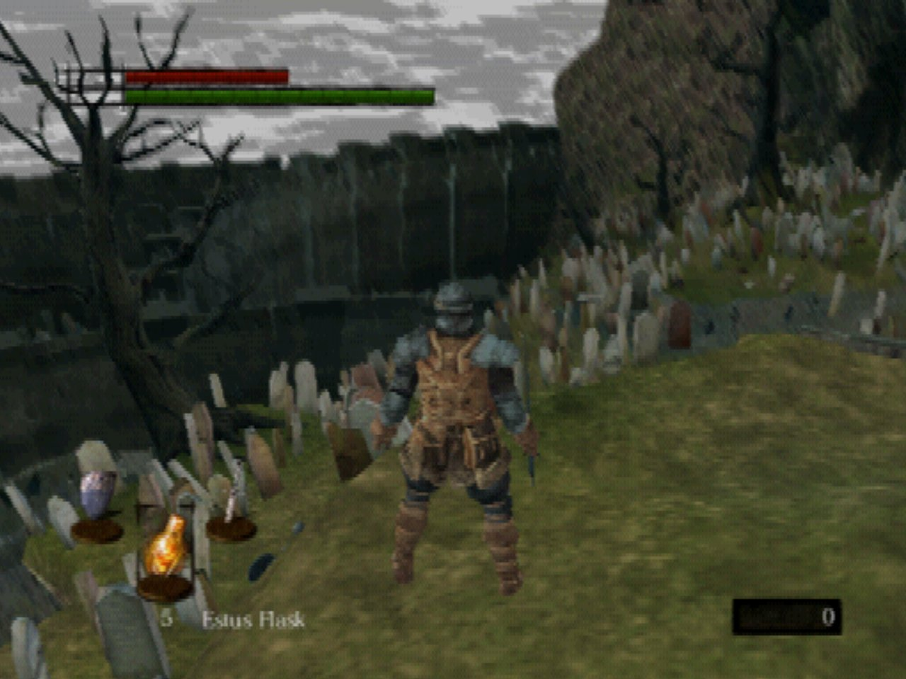

<p align="center"></p>
<p align="center"><a href="https://discord.gg/V4zMzPyQhs"></a></p>

A homebrew port of **Dark Souls Remastered** to the PlayStation 2.

- `ps2/proto`: the engine, in C, built with ps2dev and gsKit, with hand-written VU1 microprograms.
- `tools/`: Python tools that read **your own copy** of the PC game and convert its maps, characters, animations,
  collision, AI scripts and menus into PS2-sized files.

You build it from your own copy of the game and play it in PCSX2. Real PS2 hardware is set up but untested.

> [!WARNING]
> **Early prototype, not a playable game.** Only the first few areas load, most systems are missing or partial, and
> things break from day to day. Expect bugs, crashes, missing sounds and visuals that don't match DSR yet.

## What works today

| Works (partly, see `notes/PLAYTHROUGH.md`) | Not yet |
|---|---|
| Firelink Shrine, Undead Burg and the Undead Asylum as one world, with no loading screens between them. Scenery streams from the disc, nearest first. Each block's enemies, navmeshes, effects, objects and AI scripts load with it and unload when you leave | Every other area. Some scenery still pops in late |
| The Warrior: walking, running, rolling, dashing, R1 attacks, falling | Lock-on, blocking, parries, magic, two-handing, levelling |
| Enemies with their own AI scripts and navmesh routes, damage both ways, ragdoll deaths | Line of sight, guarding, item drops, most enemy types |
| Chests, item pickups, fog walls, doors, levers, gates, event warps (the crow to Firelink), boss fog walls and health bar | Boss fights as in DSR, NPC dialogue, shops, cutscenes |
| Bonfires: lighting, resting, kindling, Reverse Hollowing | Level up, attune, warp |
| Death: YOU DIED, Hollowing, respawn at the bonfire, bloodstains | The Hollow look, a full area reload on death |
| Souls and humanity from kills, humanity items, the HUD counter | Stats in combat, rings and other SpEffects |
| DSR's Start menu: Equipment, Inventory, Status, System. DSR's loading screen | Title screen, pickup prompts, other menus |
| Saving and loading on the memory card | Saving in the background |
| Sound effects, footsteps by floor, music, boss music, ambience | Higher sample rate (8 kHz now), reverb, voices |
| HUD, 30 fps in PCSX2. Tests fail if any spot gets slower than its recorded frame times | Testing on a real PS2 |

### Screenshots

| Firelink Shrine bonfire | Firelink Shrine graveyard |
|---|---|
|  |  |

## Legal note

This repository has **no game data** and no decompiled code. The only exceptions are the two screenshots above and
the logo (the Dark Souls logo recoloured, with "PS2" added). You need your own copy of Dark Souls Remastered for PC
(Steam). The build reads it and writes everything game-derived into `build/`, which git ignores. **Never share or
commit anything in `build/`.**

Dark Souls is a trademark of FromSoftware / Bandai Namco. This project isn't affiliated with or endorsed by them.
`notes/EXE_FINDINGS.md` holds only facts about the game's exe (addresses, offsets, field names, constants), each with
its source.

## Quick start

There are three ways to make a disc image (ISO). Each reads your own copy of the game. Never share the ISO.

| Way | Needs | Notes |
|---|---|---|
| `./build-iso.sh` | Linux, plus ps2dev or Docker / Podman | Recommended. One command writes `build/proto.iso`. Without ps2dev it builds in the official `ps2dev/ps2dev` container |
| [The project page](https://nekomancer01.github.io/DarkSoulsPS2/) | Chrome, Edge or Firefox on a desktop, lots of RAM | Converts the game in the browser. Nothing is uploaded. **Experimental**, see below |
| Developer setup (steps 1 to 6) | Linux, ps2dev, Python, PCSX2 | For changing code and running tests |

> [!CAUTION]
> **The in-browser converter is experimental.** It takes 10 to 20 minutes, each worker needs up to 2.5 GB of RAM,
> and its ISO has **no sound** (the browser can't decode the game's MP3 banks). It can lag behind the native build.
> If it fails, use `./build-iso.sh` and tell us what happened.

The steps below are for Linux. On Windows, use WSL2: see [Building on Windows (WSL2)](#building-on-windows-wsl2).

### 1. What you need

| Need | Notes |
|---|---|
| Dark Souls Remastered, Steam PC | Build 10943698, English, is the checked one. `python3 tools/verify_game.py` lists the others |
| ps2dev with gsKit | A release from https://github.com/ps2dev/ps2dev. Looked for in `~/tools/ps2dev-2.0.0/ps2dev`, or set `PS2DEV` |
| Python 3.10+ | With Pillow and numpy (step 3) |
| gcc, g++ | For a few small native helpers |
| libmpg123 | Decodes the sound banks (`libmpg123-0` on Debian/Ubuntu, `mpg123` on Fedora/Arch) |
| PCSX2 2.x | Flatpak `net.pcsx2.PCSX2` to play. The tests use their own runner, see [Headless test runner](#headless-test-runner) |
| RAM | Several GB for the first export |

### 2. Point the build at your game

`tools/gamepath.py` finds the game in the usual Steam libraries (native, Flatpak, Snap and every library in
`libraryfolders.vdf`). If yours is elsewhere, set the folder that holds `DarkSoulsRemastered.exe`:

```bash
export DSR_GAME="$HOME/.local/share/Steam/steamapps/common/DARK SOULS REMASTERED"
```

`DSR_GAME = ...` in `config.local.mk` (git-ignored) or `make DSR_GAME=...` also work. Then check your copy:

```bash
python3 tools/verify_game.py
```

An unknown version stops the build. `DSR_ALLOW_UNSUPPORTED=1` builds anyway.

### 3. Install the Python packages

```bash
python3 -m venv .venv && .venv/bin/pip install -r tools/requirements.txt
.venv/bin/pip install -r tools/requirements-speed.txt   # optional: reads the game's archives about 2x faster
```

The build uses `.venv` by itself. For another Python, put `PY = /path/to/python` in `config.local.mk`.

### 4. Turn on HostFs in PCSX2

The ELF build loads its files through PCSX2's `host:` device. In `PCSX2.ini` (Flatpak:
`~/.var/app/net.pcsx2.PCSX2/config/PCSX2/inis/PCSX2.ini`):

```ini
[EmuCore]
HostFs = true
```

Skip this if you only play the ISO.

### 5. Build

```bash
source ps2/env.sh
make -C ps2/proto
```

The first build converts the game data and takes several minutes. After that, only what changed is redone, and
unchanged export steps come from the build cache. `make` uses every core; `JOBS=4` limits it. The result is
`build/proto.elf`, which starts at the Firelink Shrine bonfire.

`python3 tools/buildprof.py report build` shows where the last build spent its time.

### 6. Play

```bash
tools/pcsx2-run.sh build/proto.elf
```

Or make an ISO and open it in PCSX2 like any game (no HostFs needed):

```bash
make -C ps2/proto iso      # writes build/proto.iso
```

`./build-iso.sh` does steps 5 and 6 in one go. Useful options: `-i DIR` (game folder), `-o FILE` (copy the ISO),
`-c N` (threads), `--plain` (plain log), `--help` (all). The full log goes to `build/build-iso.log`.

The occlusion (PVS) bakes use the GPU when one is found (NVIDIA, AMD or Intel with OpenGL 4.5), also in the container
build. `PVS_GPU=0`, or `tools/build-iso.sh --no-gpu`, bakes on the CPU.

**To report a bug**, play with `./play-report.sh`. It runs `build/proto.iso` with your settings, records the logs,
and takes a screenshot every 2 seconds. Type a note and press Enter to mark a moment (this also saves a savestate).
When you close PCSX2 it writes a zip to `build/play-reports/`. Attach that. It needs `python3`, ImageMagick and
`xprop`.

### Controls (DualShock 2)

| Button | Action |
|---|---|
| Left stick or d-pad | Move (tilt lightly to walk) |
| Right stick | Camera |
| Circle | Tap to roll, hold to dash |
| R1 | Attack |
| Cross | Open chests, pick up items, go through fog walls |
| Start | Menu |
| Select | Debug HUD (fps, timings, free memory) |
| L3 | Debug: helmet off / on |

For testing, `make EE_DBGINFOFLAGS=-DIDLE_DEMO` (or `option demo` in a test script) starts a demo walk after 5
seconds without input. Any button takes over.

### Headless test runner

The tests (`tools/test-run.py`, `tools/test-all.sh`, `tools/golden.py`, CI smoke runs) use `pcsx2-dsrtest`, PCSX2
v2.8.2 with no window and no sound, built from source with the front end in `tools/pcsx2-headless/` (GPLv3). It
renders with Vulkan, keeps PINE (`tools/pine.py`) and takes screenshot, GS dump, savestate and quit requests over a
control socket (`tools/pcsx2ctl.py`). Build it once:

```bash
tools/q -m 6 tools/pcsx2-headless/build.sh
```

The first run downloads PCSX2 and its libraries into `tools/ext/` and takes 5 to 40 minutes. Later runs only rebuild
what changed.

<details>
<summary>Host packages, settings and limits</summary>

`build.sh` needs `git curl patch pkg-config nasm cmake ninja` and a C++ compiler (clang if installed, else g++), plus
the dev packages for libjpeg, zlib, libcurl, libpcap, fontconfig, X11, dbus, libudev, ALSA / PulseAudio, Vulkan and
EGL. On Debian/Ubuntu:

```bash
sudo apt install clang lld nasm libjpeg-dev libcurl4-openssl-dev libpcap-dev libfontconfig-dev libx11-dev \
  libxrandr-dev libxi-dev libdbus-1-dev libudev-dev libasound2-dev libpulse-dev libegl-dev libvulkan-dev \
  extra-cmake-modules
```

- The BIOS and base settings come from your Flatpak PCSX2 config. `PCSX2_USERCFG=<dir>` picks another one. The
  runner turns on the console log itself, so tests work with any settings.
- `tools/pcsx2-run.sh <elf> <seconds> <shot.png>` runs a test. `PCSX2_HEADLESS=<binary>` picks another build,
  `PCSX2_TIMEOUT=<s>` caps the run (default 3600 s).
- A worktree without its own runner uses the main checkout's.
- Each run reserves about 7 GB of address space (it uses about 1 GB of RAM), so runs go through `tools/q -m 10`.
- `tools/pcsx2-headless/selftest.sh <elf>` checks the runner.

</details>

## Building on Windows (WSL2)

Build inside WSL2 (checked on Windows 11 with Ubuntu 24.04) and play the ISO in PCSX2 for Windows. The steps above
apply, with these differences:

| Step | Under WSL2 |
|---|---|
| Clone | Ubuntu's `git` or Git for Windows both work. Clone into WSL's own disk (`~/DarkSoulsPS2`) for speed. On `/mnt/c/...`, keep the build on WSL's disk: `ln -s ~/dsrps2-build build` |
| Packages | `sudo apt update && sudo apt install -y build-essential python3-venv libmpg123-0t64`, then step 3 |
| ps2dev | `mkdir -p ~/tools/ps2dev-2.0.0 && curl -L https://github.com/ps2dev/ps2dev/releases/download/v2.0.0/ps2dev-ubuntu-latest.tar.gz \| tar xz -C ~/tools/ps2dev-2.0.0` |
| The game | Found under `/mnt/c`, and other drives as `/mnt/<drive>`. Check it as in step 2 |
| Memory | WSL2 gets half the PC's RAM. With 16 GB or less, raise it in `%UserProfile%\.wslconfig` (`[wsl2]`, `memory=12GB`), then `wsl --shutdown` |
| Play | PCSX2 for Windows (`winget install PCSX2Team.PCSX2`) with a BIOS from your own console. Copy `build/proto.iso` to a Windows folder first: read over the WSL share, streaming lags |
| Headless tests | `export PCSX2_USERCFG=/mnt/c/Users/<you>/Documents/PCSX2` (or `.../OneDrive/Documents/PCSX2`). WSL has no GPU Vulkan, so runs render on the CPU. They are slower, but the frame times they measure don't change |
| Bug reports | `play-report.sh` needs Linux. Attach `Documents\PCSX2\logs\emulog.txt` instead |

## Troubleshooting

| Problem | Fix |
|---|---|
| `make` stops with a message about the game | It can't find the game, or the version isn't supported. See step 2 |
| Black screen, nothing loads | HostFs is off (step 4), or PCSX2 wasn't started with `tools/pcsx2-run.sh` |
| The picture goes black, the game keeps running | Out of video memory (`ERROR: Not enough VRAM` in `emulog.txt`). Please report the spot |
| `OUT OF RAM: ...` in the log | The PS2 has 32 MB and the port runs close to it. Please report the spot |
| The build is killed or the PC slows down | The export needs a lot of RAM. Close other programs and retry. `tools/q` waits for free RAM with a budget of about two thirds of it; `DSR_Q_BUDGET=<GB>` changes that |

The PCSX2 log is `emulog.txt` in PCSX2's `logs` folder (Flatpak: `~/.var/app/net.pcsx2.PCSX2/config/PCSX2/logs/`).

## More build options

```bash
make -C ps2/proto MAP=m10_01_00_00   # start in Undead Burg: build/proto_m10_01_00_00.elf
make -C ps2/proto clean              # remove compiled code only
make -C ps2/proto distclean          # also remove everything exported from the game
tools/pcsx2-run.sh build/proto.elf 8 shot.png   # headless: run 8 s, save a screenshot
tools/test-all.sh                    # full test suite
```

`build/` holds `gen/` (exported data, generated headers), `obj/`, `data/` (the packs the game loads) and the ELFs.

## Where to read next

| To… | Read |
|---|---|
| See what's missing for a full playthrough | `notes/PLAYTHROUGH.md` |
| See the plan | `notes/ROADMAP.md` |
| See how the port differs from DSR | `notes/TECH_DEBT.md` |
| Find a tool | `notes/TOOLS.md` |
| Understand the engine (Polaris) | `docs/polaris/README.md` |
| Look up file formats and engine decisions | `notes/PORTING.md` |
| Look up values from the game's exe | `notes/EXE_FINDINGS.md` |
| Contribute (people and AI agents) | `AGENTS.md` |
| Ask questions or share test results | [Join the Discord](https://discord.gg/V4zMzPyQhs) |

## Repository layout

| Path | What |
|---|---|
| `ps2/proto/` | The PS2 engine (C99; VU1 `.vsm` programs generated by `tools/vu1/gen.py`) |
| `tools/` | Exporters (`export_*.py`), file readers (`souls.py`, `havok_*.py`, `esd.py`, `lua50.py`), test tools |
| `config.mk`, `tools/gamepath.py`, `tools/verify_game.py` | Finding and checking your game |
| `ghidra/scripts/`, `fndb/` | Scripts for studying the exe (no exe data) |
| `notes/` | Design notes, plans, status |
| `AGENTS.md` | Rules for contributors (legal rules in section 1) |

## Optional development dependencies

Not needed to build or play. Some research and cross-check tools use them.

<details>
<summary>The list, and how to fetch the name references</summary>

Fetch them into `ext/` or `tools/ext/` (git-ignored). Check each licence before sharing anything built with them.

| Dependency | Used by | Licence |
|---|---|---|
| soulstruct 2.3.2, soulstruct-havok 1.2.2 + soulstruct's data files (`ext/soulstruct`) | `tools/xcheck.py` | GPL-3.0-or-later |
| SoulsFormatsNEXT, DSAnimStudio (`ext/`) | File layout references | GPL-3.0 |
| Paramdex, DarkScript3 (`ext/`) | Param and EMEVD names | See upstream |
| meshoptimizer (`tools/ext/`) | Mesh experiments | MIT |
| lz4, lz4ultra (`tools/ext/`) | Compressor experiments | BSD-2 / zlib |
| libimagequant (`tools/ext/`) | Palette experiments | GPL-3.0-or-later or commercial |
| Node.js 18+, clang + wasm-ld (LLVM 17+), pyodide | `tools/pages/convert-node.mjs` (the browser converter, run outside a browser) | MIT; Pyodide MPL-2.0 |
| vgmstream (`tools/ext/`) | Audio experiments | ISC-style |
| PCSX2 v2.8.2 source + libraries (`tools/ext/pcsx2-*`) | The headless test runner | GPL-3.0 |
| Ghidra | Exe research | Apache-2.0 |
| three.js 0.160 (from cdn.jsdelivr.net) | `tools/lodview.py` | MIT |

Without the name references the tools still run, but params keep their Japanese names and TAE events stay raw. To
fetch them:

```sh
git clone --depth 1 https://github.com/soulsmods/Paramdex ext/Paramdex          # tools/params.py ($PARAMDEX)
git clone --depth 1 https://github.com/AinTunez/DarkScript3 ext/DarkScript3     # tools/emevd.py ($DARKSCRIPT3)
git clone --depth 1 https://github.com/Meowmaritus/DSAnimStudio ext/DSAnimStudio # TAE templates
```

`tools/xcheck.py` also needs soulstruct in `.venv-tools` (steps at the top of `tools/requirements-xcheck.txt`).
Checked 2026-11-01 against Paramdex ff7245e, DarkScript3 733f024, DSAnimStudio f1bff06.

Included third-party code: `tools/native/bcdec.h` (MIT / Unlicense) and meshoptimizer 1.3's simplifier in
`tools/native/meshopt/` (MIT, `LICENSE.md` beside it).

</details>

## Licence

GPL-3.0-or-later (`LICENSE`), for the original code and docs here only. It grants no rights to FromSoftware / Bandai
Namco material.
