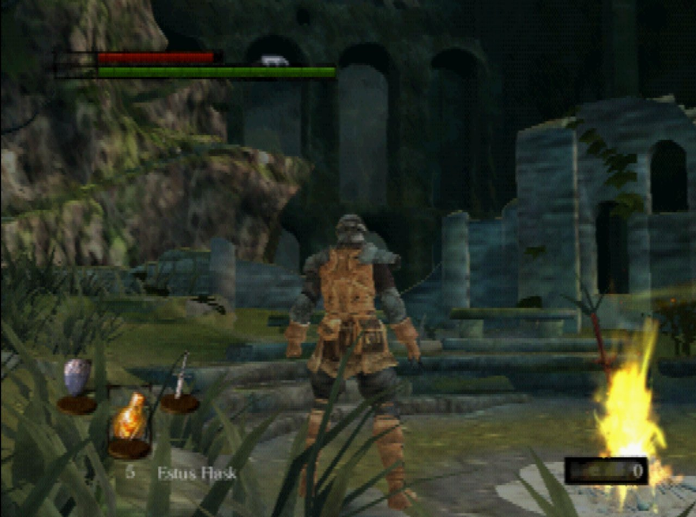
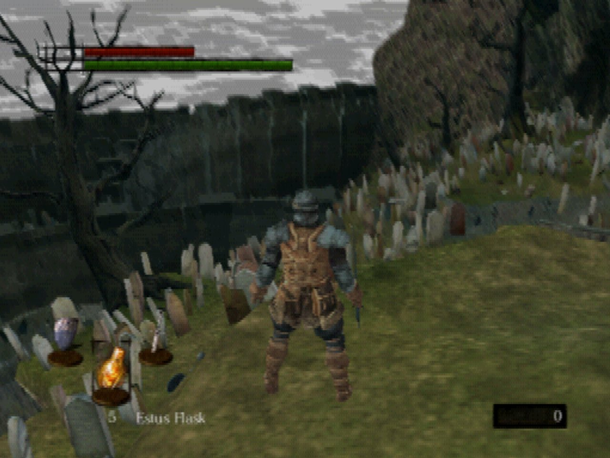

<p align="center"></p>

A homebrew port of **Dark Souls Remastered** to the PlayStation 2. It's a C engine for the PS2 (`ps2/proto`, built
with ps2dev and gsKit, with hand-written VU1 microprograms), plus Python tools (`tools/`) that read **your own copy**
of the PC game and convert its maps, characters, animations, collision, AI scripts and menus into PS2-sized files.

You build it yourself from your own copy of the game, and it runs in the PCSX2 emulator. Running it on a real PS2 is
set up but hasn't been tested.

> [!WARNING]
> **This is a heavy work in progress.** It is an early prototype, not a playable game: only the first few areas load,
> most of the game's systems are missing or partly done, and things change (and break) from one day to the next.
> Expect bugs, crashes, missing sounds and visuals that don't match DSR yet. The in-browser converter on the project
> page is especially experimental (see [Quick start](#quick-start)).

## What works today

| Works (partly, see `notes/PLAYTHROUGH.md`) | Not yet |
|---|---|
| Firelink Shrine, Undead Burg and the Undead Asylum as one world, with seamless walking between them (no loading screen). Each area's scenery streams from the disc cell by cell, nearest first | Every other area; some scenery still pops in late when read from the disc |
| The Warrior: walking, running, rolling, dashing, R1 attacks, falling | Lock-on, blocking, parries, magic, two-handing, levelling |
| Enemies with their own AI scripts and navmesh routes, taking and dealing damage, ragdoll deaths | Line of sight, guarding, item drops, most enemy types |
| Event scripts: chests, item pickups, fog walls, doors, levers and gates, event warps (the crow from the Asylum to Firelink), boss fog walls and health bar (tested on the Taurus Demon) | Boss fights as in DSR, NPC dialogue, shops, cutscenes |
| Bonfires: lighting, resting (HP, Estus and enemies reset), kindling and Reverse Hollowing from the rest menu | Level up, attune and warp at bonfires |
| Death: YOU DIED, the player turns Hollow and returns to the last bonfire, a bloodstain holds the lost souls and humanity | The Hollow look, a full area reload on death |
| Souls and humanity from kills, humanity items, the HUD humanity counter (grey while Hollow) | Stats used by combat, rings and other SpEffects |
| DSR's own Start menu screens: Equipment, Inventory (Use / Discard), Status and System, with the game's item names, help text and icons. DSR's loading screen | Title screen, item pickup prompts, the other menus |
| Saving and loading on the memory card | Saving in the background |
| Sound effects, footsteps by floor, music, boss music and area ambience | Effects at a higher sample rate (8 kHz now), reverb, voices |
| HUD (health, stamina, Estus, souls, humanity), 30 fps in PCSX2 | Testing on a real PS2 |

### Screenshots

The port running in PCSX2:

| Firelink Shrine bonfire | Firelink Shrine graveyard |
|---|---|
|  |  |

`notes/PLAYTHROUGH.md` lists every system still needed for a full playthrough, with its status.
`notes/TECH_DEBT.md` lists every known way the port differs from the original game.

## Legal note

This repository contains **no game data**: no textures, models, maps, sounds, text, scripts, params or executable
code from Dark Souls Remastered, and nothing derived from them, apart from the two screenshots above and the logo
at the top (the Dark Souls logo recoloured, with "PS2" added). It contains no
decompiled code either. You need your own legally bought copy of Dark Souls Remastered for PC (Steam). The build
reads that copy and writes every game-derived file into `build/`, which is git-ignored. **Never share or commit
anything in `build/`.**

Dark Souls is a trademark of FromSoftware / Bandai Namco. This project isn't affiliated with or endorsed by them.
`notes/EXE_FINDINGS.md` records only facts about the game's executable (addresses, offsets, field names, constants,
formulas), each with its source.

## Quick start

There are three ways to get a disc image (ISO) of the latest `main`. All of them read your own copy of the game, and
the ISO they make is yours only: never share it.

| Way | What it takes | Notes |
|---|---|---|
| `./build-iso.sh` in the repository root | A Linux shell; the steps below, or Docker / Podman | The recommended way. One command exports the game data, builds the ELF and writes `build/proto.iso`. Without a ps2dev toolchain it pulls the official ps2dev image (`ps2dev/ps2dev`) and builds in it with Docker / Podman (`tools/build-iso.sh`). `./build-iso.sh --help` lists the options |
| The project page, https://nekomancer01.github.io/DarkSoulsPS2/ | A desktop browser (Chrome, Edge or Firefox) and plenty of memory | Converts your game folder into an ISO inside the browser tab; nothing is uploaded. **Very much a work in progress**, see below |
| The full developer setup (steps 1 to 6 below) | Linux, ps2dev, Python, PCSX2 | For changing the code and running the tests |

> [!CAUTION]
> **The in-browser converter is a heavy work in progress.** It runs the port's own Python converter
> (`tools/convert.py`) in WebAssembly (Pyodide, with its C helpers built by `tools/native/build-wasm.sh`) and packs the
> game-free ELF from CI with `tools/iso9660.py`. It is slow (about 10 to 20 minutes), each worker needs up to about
> 2.5 GB of memory and can fail on PCs with less, the ISO it makes has **no sound yet** (the game's MP3 sound banks
> can't be decoded in the browser), and it may lag behind or break when the native build changes. If it fails or
> the result misbehaves, use `./build-iso.sh` instead and please report what happened.

Tested on Linux. The steps assume a Linux shell; Windows users should use WSL or a Linux VM.

### 1. What you need

| Need | Notes |
|---|---|
| Dark Souls Remastered, Steam PC version | Build 10943698 with English data is the one that's checked. `python3 tools/verify_game.py` lists supported versions. |
| ps2dev toolchain with gsKit | Get a ps2dev release from https://github.com/ps2dev/ps2dev. `ps2/env.sh` looks for it in `~/tools/ps2dev-2.0.0/ps2dev`; set `PS2DEV=/your/path` if it's elsewhere. |
| Python 3.10 or newer | The tools need Pillow and numpy (step 3). |
| gcc, g++ | Compile a few small native helpers on first use (g++: meshoptimizer's simplifier for the far horizon level). |
| libmpg123 | Decodes the game's MP3 sound banks for the sound packs (Debian/Ubuntu `libmpg123-0`, Fedora/Arch `mpg123`). |
| PCSX2 2.x | The Flatpak `net.pcsx2.PCSX2` is what the run scripts use. |
| RAM | The first full export needs several GB. |

### 2. Tell the build where your game is

The game folder is the one that holds `DarkSoulsRemastered.exe`. Usually you don't need to do anything:
`tools/gamepath.py` searches the usual Steam libraries (native, Flatpak and Snap Steam, and every library in
`libraryfolders.vdf`). If yours is somewhere else, use one of these:

```bash
export DSR_GAME="$HOME/.local/share/Steam/steamapps/common/DARK SOULS REMASTERED"
```

or put `DSR_GAME = /path/to/DARK SOULS REMASTERED` in `config.local.mk` at the repo root (git-ignored), or pass
`make DSR_GAME=...`.

Then check your copy:

```bash
python3 tools/verify_game.py
```

It hashes the exe and the data files the exporters need. An unknown version stops the build with a message;
`DSR_ALLOW_UNSUPPORTED=1` builds anyway, for trying a newer patch.

### 3. Install the Python packages

```bash
python3 -m venv .venv && .venv/bin/pip install -r tools/requirements.txt
```

The build uses `.venv` automatically. To use a different Python, put `PY = /path/to/python` in `config.local.mk`.

### 4. Turn on HostFs in PCSX2

The game loads its files from your disk through PCSX2's `host:` device. In PCSX2's `PCSX2.ini` (Flatpak:
`~/.var/app/net.pcsx2.PCSX2/config/PCSX2/inis/PCSX2.ini`), set:

```ini
[EmuCore]
HostFs = true
```

You can skip this if you only play the ISO build (step 6).

### 5. Build

```bash
source ps2/env.sh
make -C ps2/proto
```

The first build converts the game data. It takes several minutes and several GB of RAM. Later builds only redo what
changed. `make` uses every CPU core by default; `make -j4` (or `JOBS=4`) limits it. The result is `build/proto.elf`, which starts at the Firelink Shrine bonfire.

### 6. Play

```bash
tools/pcsx2-run.sh build/proto.elf
```

Or build a disc image and open it in PCSX2 like any game (HostFs isn't needed for this):

```bash
make -C ps2/proto iso      # writes build/proto.iso
```

`./build-iso.sh` in the repository root does steps 5 and 6 in one command: it exports the game data, builds the ELF
and writes `build/proto.iso`. `-i DIR` picks the game folder, `-o FILE` also copies the ISO elsewhere, `-c N` sets
how many CPU threads it uses; `--help` lists every option. Without a ps2dev toolchain on the host it pulls the official
ps2dev image (`ps2dev/ps2dev:v2.0.0`) and builds in a container on it with Docker or Podman (`tools/build-iso.sh`).

To report a problem, play with `./play-report.sh` instead of opening the ISO yourself. It starts PCSX2 with
`build/proto.iso` and your own settings and memory cards, records PCSX2's log with the game's, and takes a screenshot of
the window every 2 seconds. Type a note in its terminal and press Enter to mark the moment something goes wrong (it also
saves a savestate there). When you close PCSX2 it writes one zip to `build/play-reports/` (a summary, the log, the
screenshots, your marks): attach that file to the report. `--help` lists the options. It needs `python3`, and for the
screenshots ImageMagick and `xprop`.

### Controls (DualShock 2)

| Button | Action |
|---|---|
| Left stick or d-pad | Move (a light tilt walks) |
| Right stick | Camera |
| Circle | Tap to roll, hold to dash |
| R1 | Attack |
| Cross | Action: open chests, pick up items, go through fog walls |
| Start | Menu |
| Select | Debug HUD (fps, timings, free memory) |
| L3 | Debug: helmet off / on |

The player is always under your control. The old idle demo walk is kept for testing only: build with
`make EE_DBGINFOFLAGS=-DIDLE_DEMO` (or put `option demo` in a test script) and it starts after 5 seconds without input;
press any button to take over.

## Troubleshooting

| Problem | Cause and fix |
|---|---|
| `make` stops at once with a message about the game | It can't find your game folder, or the version isn't supported. See step 2. |
| PCSX2 shows a black screen or loads nothing | HostFs is off (step 4), or you started PCSX2 yourself without the run script. Use `tools/pcsx2-run.sh`. |
| The picture goes black while the game keeps running | Video memory ran out. PCSX2's log (`emulog.txt`) says `ERROR: Not enough VRAM`. Please report it with the spot. |
| `OUT OF RAM: ...` in the PCSX2 log | The PS2 has 32 MB of RAM and the port runs close to it. Please report it with the spot. |
| The build is killed or the PC slows down | The export needs a lot of RAM. Close other programs and run it again; heavy jobs go through `tools/q`, which waits for free RAM. |

For a report, `./play-report.sh` collects all of this for you (see step 6). The PCSX2 log is `emulog.txt` in PCSX2's `logs` folder (Flatpak: `~/.var/app/net.pcsx2.PCSX2/config/PCSX2/logs/`).

## More build options

```bash
make -C ps2/proto MAP=m10_01_00_00   # start in Undead Burg: build/proto_m10_01_00_00.elf
make -C ps2/proto clean              # remove compiled code only
make -C ps2/proto distclean          # also remove everything exported from the game
tools/pcsx2-run.sh build/proto.elf 8 shot.png   # headless test: run 8 s, save a screenshot
tools/test-all.sh                    # full test suite: builds, smoke tests, render and perf checks
```

`build/` holds `gen/` (exported data and generated headers), `obj/`, `data/` (the compressed packs the game loads)
and the `proto*.elf` files. `ps2/proto/proto.elf` and `ps2/proto/data` are links into `build/`.

## Where to read next

| If you want to… | Read |
|---|---|
| See what's missing before the whole game plays | `notes/PLAYTHROUGH.md` |
| See the plan by priority | `notes/ROADMAP.md` |
| Know how the port differs from the original | `notes/TECH_DEBT.md` |
| Find a tool or script | `notes/TOOLS.md` |
| Understand file formats and engine decisions | `notes/PORTING.md` |
| Look up values found in the game's exe | `notes/EXE_FINDINGS.md` |
| Contribute (people and AI agents) | `AGENTS.md` |

## Repository layout

| Path | What |
|---|---|
| `ps2/proto/` | The PS2 engine (C99; the VU1 `.vsm` programs are generated by `tools/vu1/gen.py`) |
| `tools/` | Exporters (`export_*.py`), file readers (`souls.py`, `havok_*.py`, `esd.py`, `lua50.py`), test and reference tools |
| `config.mk`, `tools/gamepath.py`, `tools/verify_game.py` | Finding and checking your game folder |
| `ghidra/scripts/`, `fndb/` | Scripts for studying the game's exe (no exe data included) |
| `notes/` | Design notes, plans and status |
| `AGENTS.md` | Rules for contributors, people and AI agents alike (the legal rules are in section 1) |

## Optional development dependencies

You don't need these to build or play. Some cross-check and research tools use them. Fetch them yourself into `ext/`
or `tools/ext/` (git-ignored), and check each project's licence before sharing anything built with them.

| Dependency | Used by | Licence |
|---|---|---|
| soulstruct 2.3.2, soulstruct-havok 1.2.2 (PyPI) + data files from the soulstruct git repo (`ext/soulstruct`) | `tools/xcheck.py` etc. (format cross-checks) | GPL-3.0-or-later |
| SoulsFormatsNEXT, DSAnimStudio (`ext/`) | Reference for file layouts | GPL-3.0 |
| Paramdex, DarkScript3 (`ext/`) | Param / EMEVD names | See upstream |
| meshoptimizer (`tools/ext/`) | Mesh experiments | MIT |
| lz4, lz4ultra (`tools/ext/`) | Compressor experiments | BSD-2 (lib) / zlib |
| libimagequant (`tools/ext/`) | Palette quantisation experiments | GPL-3.0-or-later or commercial |
| Node.js 18+, clang + wasm-ld (LLVM 17+); pyodide (npm, fetched into `build/cache/pyodide-node` on first use) | `tools/pages/convert-node.mjs` (the in-browser converter run outside a browser, to compare its packs with a native build) | Node: MIT; Pyodide: MPL-2.0 |
| vgmstream (`tools/ext/`) | Audio experiments | ISC-style |
| PCSX2 source (`tools/ext/pcsx2-src`) | Emulator debugging | GPL-3.0 |
| Ghidra | Exe research (`ghidra/scripts`) | Apache-2.0 |
| three.js 0.160 (loaded from cdn.jsdelivr.net by the page) | `tools/lodview.py` (LOD budget viewer) | MIT |

The name and layout references are read from fixed paths under `ext/` (or the environment variable, if set). Without
them the tools still run: param rows keep their Japanese names, TAE events stay raw words, and EMEVD instructions keep
their Japanese names (106 instruction uses that DSR's own `common.emedf` lacks don't decode). To fetch them:

```sh
git clone --depth 1 https://github.com/soulsmods/Paramdex ext/Paramdex          # tools/params.py: DS1R/Names, DS1R/Defs ($PARAMDEX)
git clone --depth 1 https://github.com/AinTunez/DarkScript3 ext/DarkScript3     # tools/emevd.py: DarkScript3/Resources/ds1-common.emedf.json ($DARKSCRIPT3)
git clone --depth 1 https://github.com/Meowmaritus/DSAnimStudio ext/DSAnimStudio # souls.tae_template, xcheck.py tae: DSAnimStudioNETCore/Res/TAE.Template.DS1*.xml
```

`tools/xcheck.py` also needs soulstruct in `.venv-tools`: the install steps are at the top of
`tools/requirements-xcheck.txt` (the PyPI wheel lacks soulstruct's data files, so they come from a clone in
`ext/soulstruct`). Checked 2026-11-01 against Paramdex ff7245e, DarkScript3 733f024, DSAnimStudio f1bff06.

`tools/native/bcdec.h` (BC texture decoder, MIT / Unlicense) is included with its licence header.
`tools/native/meshopt/` holds meshoptimizer 1.3's simplifier (https://github.com/zeux/meshoptimizer, MIT, `LICENSE.md`
beside it), used by `tools/horizon.py`; built into `tools/native/libmeshopt.so` on first use.

## Licence

GPL-3.0-or-later (`LICENSE`). It covers only the original code and docs in this repository. No game files are
included, and it grants no rights to FromSoftware / Bandai Namco material. You need your own copy of Dark Souls
Remastered.
